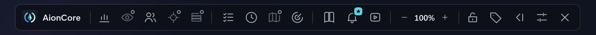
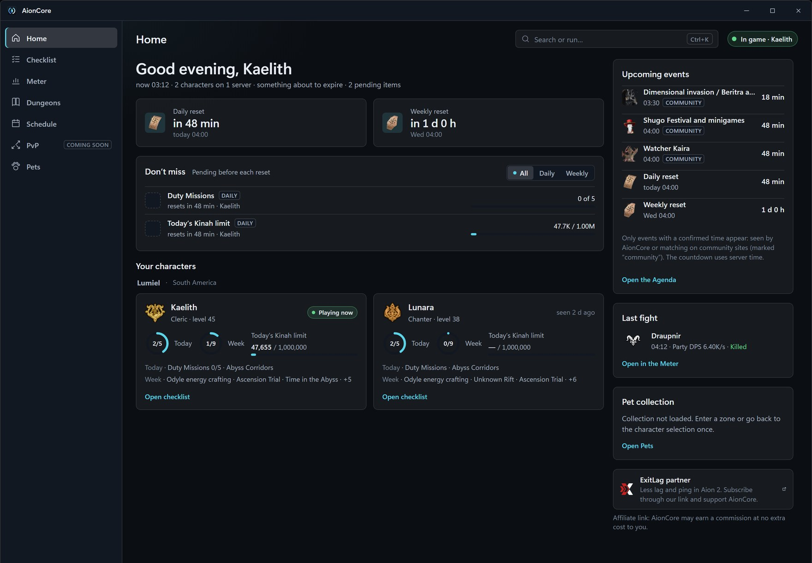
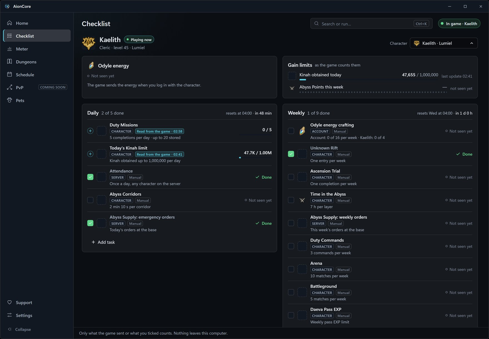
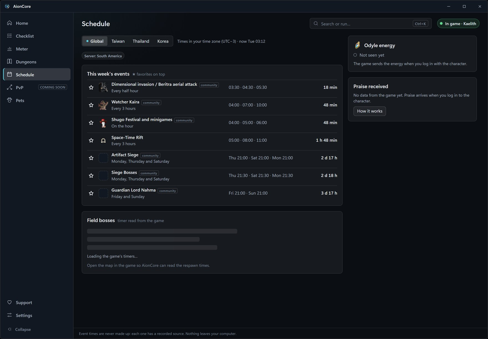
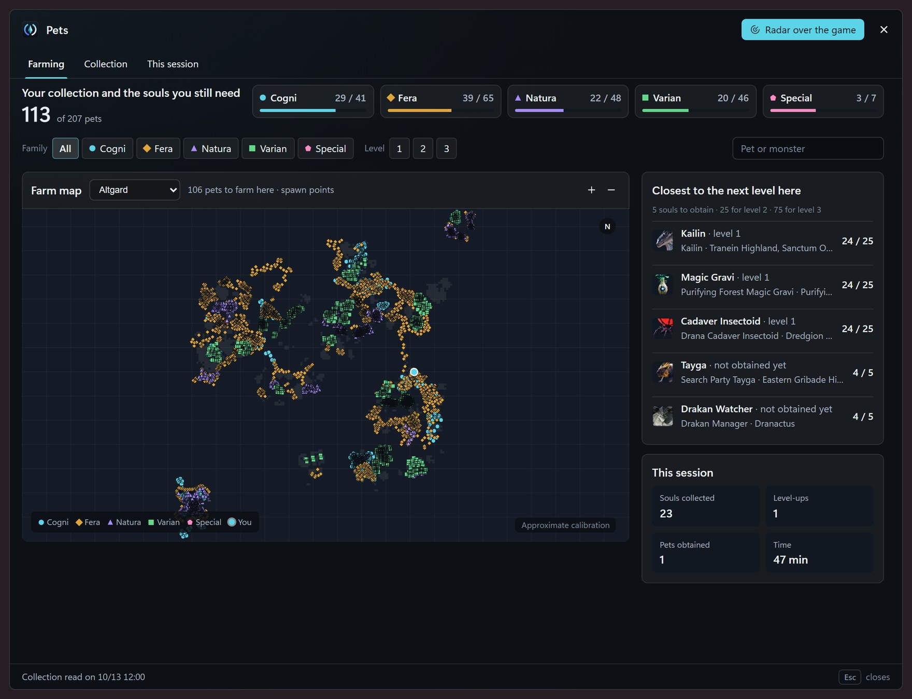
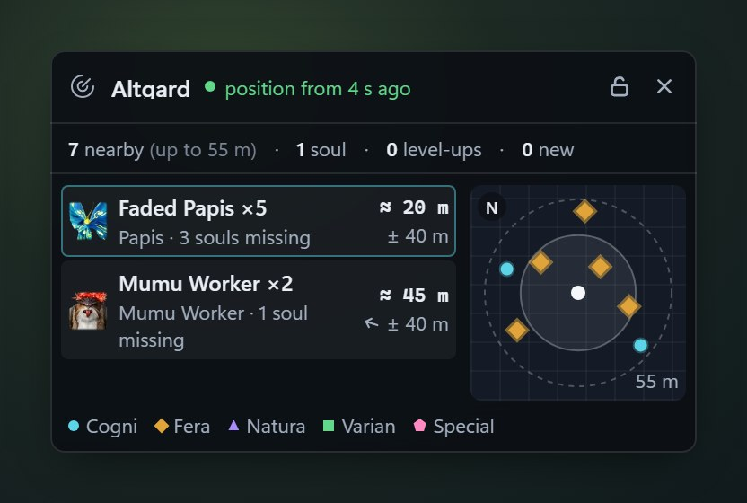

<div align="center">

[English](README.md) · [Português (Brasil)](README.pt-BR.md) · **Español**

<picture>
  <source media="(prefers-color-scheme: dark)" srcset="media/aioncore-logo-dark.svg">
  <source media="(prefers-color-scheme: light)" srcset="media/aioncore-logo-light.svg">
  
</picture>

### Mira el DPS de tu grupo, encuentra el Cubo Oculto y contrólalo todo desde una barra sobre el juego.<br>Una app gratis para Aion 2 en Windows.

[](https://github.com/filvoch/AionCoreUpdate/releases/latest)


<a href="https://github.com/filvoch/AionCoreUpdate/releases/latest/download/AionCore-Setup.exe"></a>

<sub>Instalador de unos 160 MB · se actualiza solo · Windows 10 u 11, 64 bits · [Todas las versiones](https://github.com/filvoch/AionCoreUpdate/releases) · [Sitio web](https://aioncore.app/es) · [Discord](https://aioncore.app/discord)</sub>


</div>

> [!NOTE]
> El medidor necesita [Npcap](https://npcap.com) (el instalador lo comprueba y avisa si falta), y Aion 2 debe estar en modo **Ventana sin bordes** o **Ventana**. Mira [Instala en 3 pasos](#instala-en-3-pasos).

## Por qué descargarlo

- **Descubre quién cargó el combate.** Daño, DPS y porcentaje de cada jugador del grupo, habilidad por habilidad.
- **No pierdas ningún combate.** Cada combate queda en el historial de tu PC, para compararlo con el siguiente intento.
- **Encuentra el Cubo Oculto.** El radar se abre solo cuando el juego muestra un cubo cerca y te dice adónde ir.
- **Todo en una barra sobre el juego.** Un botón para cada ventana, un candado que deja pasar el clic y nada delante cuando abres el mapa o el inventario.

## Novedades de la 1.16

- **AionCore Theme**, el nuevo visual del medidor para quienes apoyan: parte superior en dos líneas, flecha de tendencia en cada jugador, columnas por rol, copiar el DPS del grupo al chat y captura solo del medidor, con un clic.
- **Para todos:** los nombres de los efectos (aturdimiento, quemadura, frenesí de los jefes y más) aparecen en **Buffs** y en el Historial; si activas una VPN o un reductor de ping después de abrir AionCore, encuentra la conexión por sí solo en 15 segundos como máximo; y el ping ahora tiene color.
- **Corregido para todos:** la recuperación de MP, DP y AP ya no cuenta como curación de HP, y la curación, los escudos y el daño recibido que llegan después del final del combate ya no suman.

[Todo lo que cambió](https://github.com/filvoch/AionCoreUpdate/releases/latest) · [Las pantallas nuevas en el sitio](https://aioncore.app/es/novo)

## Medidor de DPS del grupo

- **Todo el grupo de un vistazo:** una fila por jugador con daño, DPS y porcentaje. Pestañas **HPS** y **Recibido** para la curación y el daño recibido. Alcance **Yo**, **Grupo**, **Raid** o **Automático**.
- **Cada habilidad al detalle:** haz clic en un nombre y mira golpes, críticos, golpes por la espalda, multigolpes, promedio, mínimo y máximo, gráfico y registro.
- **Tiempos del jefe:** HP del jefe en números, **Derrota en** (estimación según lo rápido que baja el HP) y **Furia en** para jefes con tiempo de furia conocido.
- **Cada combate guardado en tu PC:** **Historial**, resumen de cada combate, **Comparar combates**, **Runs de jefes**, resumen de tu muerte y exportar a JSON, CSV o PNG.
- **Grupo flotante:** la vida de tu grupo en una ventana pequeña.
- **Cinco visuales gratis:** Franjas, Clásico, Denso, Panel y Cristal, y el **acabado Cristal** sobre Denso, Panel y Franjas.

<p align="center"></p>

## Radar de Cubos Ocultos

Una ventanita que se abre sola cuando el juego muestra un Cubo Oculto cerca de ti y desaparece cuando no hay ninguno.

- **Automático:** se abre cuando aparece un cubo aún cerrado y se oculta unos 3 segundos después de que desaparece el último. ¿Prefieres verlo siempre? Activa **Mantener el radar siempre visible**.
- **Norte fijo**, como el minimapa del juego, o **Gira contigo**.
- **Varios cubos:** el cubo actual tiene el punto más grande y la línea; el texto muestra «+N más».
- **Avisos que te dicen adónde ir:** a menos de 80, 50, 25 y 10 m, si el cubo está a tu derecha, delante o detrás, y cuando otro jugador ya lo abrió.

El radar muestra solo los cubos que envía el juego. El juego solo informa tu posición cuando usas una habilidad o un dash; sin una posición reciente, el radar muestra «Cubo detectado» y te pide que te muevas. Todo está en **Configuración › Avisos y eventos**.

<p align="center"></p>

## Barra superior y ventana principal

- **Barra superior:** un botón para el medidor, el grupo flotante, el checklist, los temporizadores, el radar de mascotas, los avisos de mecánica, la guía de mazmorras y YouTube. El candado bloquea todo y el clic pasa directo al juego. Opacidad de 20 % a 100 % y modo contraído.
- **Ventana principal:** Inicio con la cuenta regresiva para el reinicio diario y semanal, tus personajes, los próximos eventos y tu último combate; Ctrl+K busca pantallas y comandos. Se abre desde la barra, la bandeja de Windows o con Ctrl+Alt+A.
- **Sin estorbar:** la barra y los overlays se ocultan cuando otro programa está delante y cuando se abre un menú del juego (Esc, mapa, inventario). Con **Abrir AionCore como administrador** activado, AionCore solo comprueba si las teclas Alt y Esc están pulsadas, solo con el juego en primer plano; ninguna otra tecla, y no se graba ni se envía nada. Sin el modo administrador, se guía por el cursor del juego. Se desactiva en **Configuración › En el juego**.
- **Atajos Ctrl+Alt** que funcionan sobre el juego (M medidor, G grupo, H contraer la barra, L bloquear, K clic transparente, D ocultar todo). Si otro programa ya usa uno, AionCore te ofrece cambiarlo.
- Amenaza, Objetivo PvP, Arena y Mapa aparecen atenuados en la barra: **próximamente**.

<p align="center"></p>

<p align="center"></p>

## Mecánicas de jefe

- **Panel de mecánicas:** lo que hace el jefe y lo que debes hacer tú, por mazmorra. Gratis. La cobertura crece con cada versión, y las mecánicas aún no comprobadas en el juego vienen marcadas.
- **Avisos de mecánica en pantalla:** de una a tres palabras en la parte superior de la pantalla antes del golpe. Primero para quienes apoyan; para todos a partir del **10 de noviembre de 2026**.

## En validación

Ya vienen en el instalador y pasaron las pruebas automáticas, pero todavía no se comprobaron en vivo en el juego:

- **Checklist:** tareas diarias y semanales por personaje. Las Misiones del Deber, el límite de Kinah del día, los Puntos del Abismo de la semana y la Energía de Od se leen del juego; el resto lo marcas tú.
- **Agenda y Temporizadores:** los eventos de la semana con cuenta regresiva y los jefes de campo leídos del juego al abrir el mapa del mundo.
- **Mascotas:** tu colección por familia, las almas que te faltan y dónde farmearlas. El **radar de mascotas** muestra los monstruos cercanos que dan un alma que te falta; viene desactivado.

<table>
  <tr>
    <td width="50%"></td>
    <td width="50%"></td>
  </tr>
  <tr>
    <td align="center"><sub>Checklist</sub></td>
    <td align="center"><sub>Agenda</sub></td>
  </tr>
  <tr>
    <td width="50%"></td>
    <td width="50%"></td>
  </tr>
  <tr>
    <td align="center"><sub>Mascotas</sub></td>
    <td align="center"><sub>Radar de mascotas</sub></td>
  </tr>
</table>

¿Viste algo raro? Cuéntanoslo en [Discord](https://aioncore.app/discord) o abre un [issue](https://github.com/filvoch/AionCoreUpdate/issues).

## Instala en 3 pasos

Requisitos: Windows 10 (1809 o más nuevo) u 11, 64 bits.

1. [Descarga el instalador](https://github.com/filvoch/AionCoreUpdate/releases/latest/download/AionCore-Setup.exe) y ejecútalo. Se instala solo para tu usuario. Si Windows muestra «Windows protegió su PC», haz clic en **Más información** y luego en **Ejecutar de todas formas** ([por qué](#preguntas-frecuentes)).
2. Instala [Npcap](https://npcap.com) una vez, marcando *Install Npcap in WinPcap API-compatible Mode* y *Support loopback traffic*. Si falta, el instalador de AionCore avisa y abre el sitio de Npcap al final.
3. Abre AionCore desde el acceso directo. En Aion 2, usa **Ventana sin bordes** o **Ventana**: Windows no deja que nada aparezca sobre la pantalla completa exclusiva.

La primera vez eliges el idioma y la región y lees el aviso de uso y datos. Conectar tu cuenta de Discord es opcional. App y sitio web en 6 idiomas: español, inglés, portugués, alemán, francés y ruso (alemán, francés y ruso son traducción automática revisada, aún sin revisión de hablantes nativos).

AionCore se actualiza solo: comprueba la firma digital del instalador y no se instala por sí solo mientras Aion 2 está abierto (si haces clic en **Actualizar** con el juego abierto, te pregunta antes, y el medidor pierde el combate en curso). Tu configuración y tu historial de combates se conservan entre versiones.

## Para quienes apoyan

AionCore es gratis. Si quieres ayudar a mantenerlo, puedes apoyar en Ko-fi con cualquier monto. Un pago único de **US$ 15 o más, en dólares** (el artículo de la tienda de Ko-fi o una donación única) te convierte en **persona que apoya durante 12 meses**, **sin renovación automática**. Los montos menores son un agradecimiento, sin ventajas. **Todo lo que ya salió gratis sigue gratis para siempre.**

Lo que tiene hoy quien apoya:

- **AionCore Theme:** el nuevo visual del medidor, con parte superior en dos líneas, flecha de tendencia en cada jugador, hasta 4 columnas por rol (Tanque, DPS y Sanador), **Solo yo** con tus mejores habilidades, copiar el DPS del grupo al chat (AionCore solo copia; quien pega eres tú) y captura solo del medidor.
- **Avisos fuera del juego:** ¿hiciste alt-tab o minimizaste el juego? Las invitaciones de grupo y de Expedición, las llamadas para entrar y las solicitudes de entrada aparecen sobre cualquier ventana. Haz clic y AionCore trae el juego al frente; nunca hace clic ni acepta nada por ti.
- **Panel de sala:** quién está en la sala, el GS y el poder de combate de cada uno y quién está listo.
- **Tarjeta del candidato:** quien pide entrar en tu sala aparece en una ventanita con clase, nivel, GS y los combates que ya jugaron juntos, y puedes consultar el resumen de su perfil público en el sitio.
- **Temas de color** del medidor.
- **Antes que nadie:** avisos de mecánica de jefe (hasta el 10/11/2026) y avisos de la barra de guardia del jefe (hasta el 11/11/2026).

<table>
  <tr>
    <td width="50%"></td>
    <td width="50%"></td>
  </tr>
  <tr>
    <td align="center"><sub>Avisos fuera del juego</sub></td>
    <td align="center"><sub>Panel de sala</sub></td>
  </tr>
</table>

[Apoya a AionCore](https://aioncore.app/es/apoie)

<sub>Sin publicidad pagada. En Inicio y en Configuración › Acerca de hay una tarjeta de socio (enlace de afiliado), avisada en pantalla: AionCore puede recibir una comisión sin costo extra para ti.</sub>

## Tus datos

Tus combates se quedan en tu PC. Sin conectar una cuenta, ningún combate sale de él. Conectar la cuenta (con Discord) es opcional; al conectarla, un aviso muestra lo que va a [aioncore.app](https://aioncore.app/es) y se activa el envío de los combates de jefe y de las inspecciones. Se desactiva con un clic en **Configuración › Cuenta y envío**. Detalles en la [política de privacidad](https://aioncore.app/es/privacidade).

## Preguntas frecuentes

<details>
<summary><b>¿Me pueden banear?</b></summary>

AionCore lee el tráfico de red de tu PC y el título de la ventana del juego. No cambia archivos ni la memoria del juego. No envía teclas ni clics al juego: copiar el DPS al chat solo copia, quien pega eres tú. Aun así, ninguna herramienta de este tipo puede garantizar lo que decida la política del juego: el riesgo de usarla es tuyo.
</details>

<details>
<summary><b>¿AionCore lee lo que escribo?</b></summary>

No. Con **En los menús del juego** activado y AionCore ejecutándose como administrador, solo comprueba si las teclas Alt y Esc están pulsadas, y solo con Aion 2 en primer plano, para saber si se abrió un menú del juego. No lee ninguna otra tecla, y no se graba ni se envía nada. Se desactiva en **Configuración › En el juego**.
</details>

<details>
<summary><b>¿Qué servidores y regiones funcionan?</b></summary>

Hecho y probado en Aion 2 Global (servidores de Sudamérica). En otras regiones (Taiwán, Corea) puede funcionar, pero aún no está garantizado.
</details>

<details>
<summary><b>¿El medidor es preciso?</b></summary>

Cuenta lo que envía el juego. En algunos casos el medidor no ve todo, y avisa cuando no está leyendo el juego. El sitio explica cómo mide: [precisión](https://aioncore.app/es/precisao).
</details>

<details>
<summary><b>¿Hay que ejecutarlo como administrador?</b></summary>

No por defecto: AionCore se instala solo para tu usuario y se abre sin pedir permisos de administrador. Tres casos lo cambian:

- Si tu Npcap se instaló con la opción *Restrict Npcap driver's access to Administrators only*, el medidor muestra el botón **Reabrir como administrador** (vale solo esa vez). Para no necesitarlo nunca, reinstala Npcap sin marcar esa opción.
- **En los menús del juego** (ocultar la barra y los overlays cuando se abre un menú del juego): para ver si Alt y Esc están pulsadas con el juego en primer plano, AionCore tiene que ejecutarse como administrador. Sin eso, se guía por el cursor del juego.
- Si Aion 2 se ejecuta como administrador, el clic en un aviso fuera del juego solo trae el juego al frente si AionCore también se ejecuta como administrador.

Para estos casos existe **Configuración › General › Abrir AionCore como administrador**, desactivado por defecto. Al activarlo, Windows pide el permiso (UAC).
</details>

<details>
<summary><b>La barra o el medidor desaparecen cuando el juego está al frente.</b></summary>

El juego está en **Pantalla completa** exclusiva, y Windows no muestra ventanas encima. En las opciones de video de Aion 2, cambia a **Ventana sin bordes**.
</details>

<details>
<summary><b>Windows o el antivirus avisó al instalar.</b></summary>

El instalador no tiene un certificado de firma de código de pago, así que Windows no conoce al editor y muestra «Windows protegió su PC». Haz clic en **Más información** y luego en **Ejecutar de todas formas**. Un antivirus puede pedir confirmación por el mismo motivo. Para comprobar que el archivo es el original, compara el valor `sha256` de `latest.json` (en los Assets de la [versión más reciente](https://github.com/filvoch/AionCoreUpdate/releases/latest)) con el resultado de:

```powershell
Get-FileHash .\AionCore-Setup.exe
```
</details>

<details>
<summary><b>¿Qué sale de mi PC?</b></summary>

Sin una cuenta conectada, ningún combate sale de tu PC. AionCore descarga los iconos de las habilidades desde la CDN del juego y consulta este repositorio para saber si hay versión nueva. Con la cuenta conectada, van a aioncore.app los combates de jefe y las inspecciones, como dice el aviso antes de activarse; se desactiva en **Configuración › Cuenta y envío**. La consulta del perfil en la tarjeta del candidato envía solo nombre y servidor (se desactiva en **Configuración › Avisos y eventos › Invitación de grupo**).
</details>

<details>
<summary><b>¿Cómo lo desinstalo? ¿Pierdo mis datos?</b></summary>

*Configuración de Windows › Aplicaciones instaladas › AionCore*. El desinstalador pregunta si también borra tus datos (historial, configuración); por defecto los conserva. Instalar una versión nueva encima también conserva todo.
</details>

<details>
<summary><b>¿Es oficial? ¿El código es abierto?</b></summary>

No y no. AionCore es un proyecto independiente, hecho por un jugador, sin vínculo con NCSOFT. El código fuente no es público: este repositorio guarda solo los instaladores publicados y esta página.
</details>

## Comunidad y contacto

- **Discord:** [aioncore.app/discord](https://aioncore.app/discord)
- **Errores:** abre un [issue](https://github.com/filvoch/AionCoreUpdate/issues) o escribe a contato@aioncore.app.
- **En la app:** **Configuración › Ayuda y diagnóstico**.

## Créditos

AionCore por **Guilherme Filvoch (Simavi)**.
Proyecto independiente de fans, sin vínculo con NCSOFT. Aion 2 y sus iconos, nombres y artes pertenecen a NCSOFT y a sus licenciantes.
