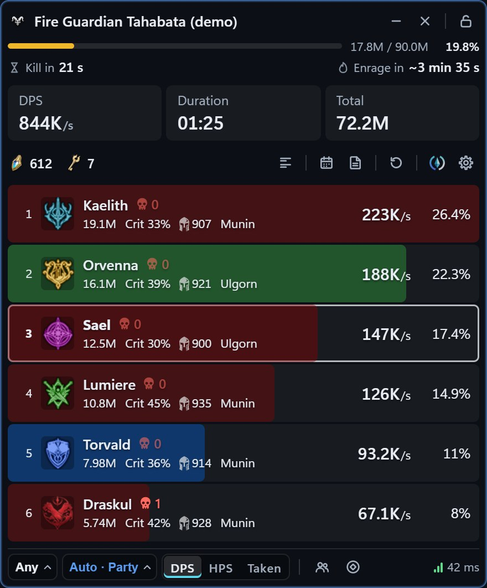
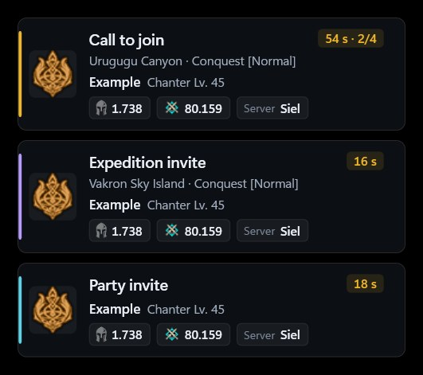
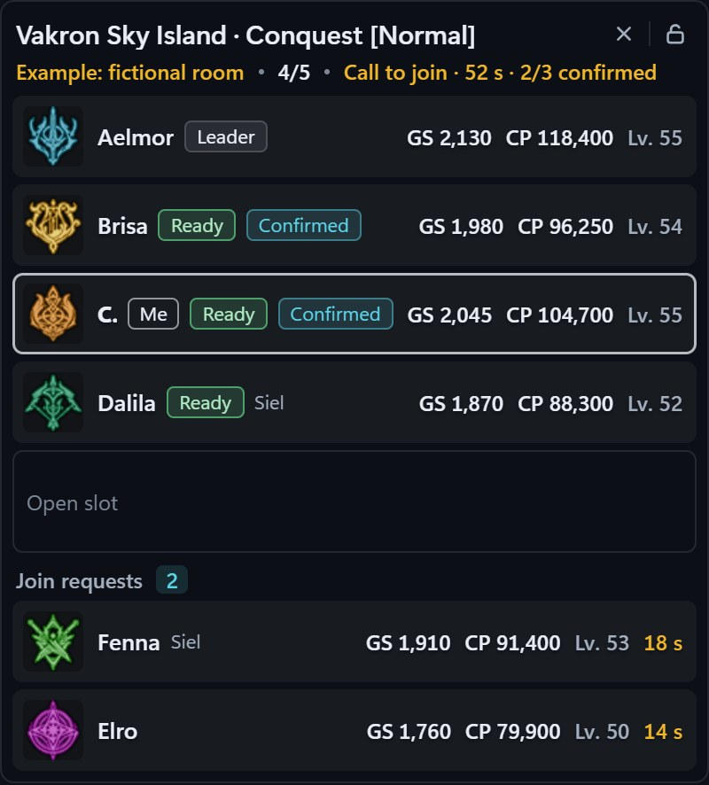

<div align="center">

**English** · [Português (Brasil)](README.pt-BR.md) · [Español](README.es.md)

<picture>
  <source media="(prefers-color-scheme: dark)" srcset="media/aioncore-logo-dark.svg">
  <source media="(prefers-color-scheme: light)" srcset="media/aioncore-logo-light.svg">
  
</picture>

### Find Hidden Cubes, read your Party's DPS and never miss a call.<br>A free companion app for Aion 2 on Windows.

[](https://github.com/filvoch/AionCoreUpdate/releases/latest)


<a href="https://github.com/filvoch/AionCoreUpdate/releases/latest/download/AionCore-Setup.exe"></a>

<sub>About 160 MB installer · updates itself · [All versions](https://github.com/filvoch/AionCoreUpdate/releases) · [Website](https://aioncore.app/en/)</sub>


</div>

> [!NOTE]
> The meter needs [Npcap](https://npcap.com), and Aion 2 must run in **Windowed** or **Borderless window** mode. See [Install in 3 steps](#install-in-3-steps).

## Hidden Cube radar

A small window that opens by itself when the game reports a Hidden Cube near you, and hides again when none are left.

- **Automatic.** On by default: it opens when an unopened Hidden Cube appears and hides about 3 seconds after the last one is gone. The ✕ dismisses only the current cubes; the next one opens the radar again.
- **North up**, like the in-game minimap, with an arrow for where you are facing. Prefer it to rotate with you? Pick **Turns with you**.
- **Several cubes at once.** The cube you are tracking gets the big dot and the line; the others are smaller, and the text shows "+N more".
- **See the game through it.** Radar opacity goes from 30% to 100%.
- **Alerts that tell you where to go:** at 80, 50, 25 and 10 m, where the cube is from you (ahead, behind, to your right...), and when another player has already opened it.
- **Next spot.** After a cube is opened, the alert points to the nearest known spawn spot, like "~240 m northeast". The meter ships with 3,722 spots where cubes have spawned (direction and distance are still being checked in game).

Everything is in **Settings › Alerts and events**. The radar shows only cubes the game sends. The game reports your own position only when you use a skill or dash, so without a recent position the radar shows "Cube detected" and asks you to move.

<p align="center"></p>

## Party DPS meter

- **The whole Party at a glance:** one row per player with damage, DPS and share. **HPS** and **Taken** tabs for healing and damage taken. Scope **Me**, **Party**, **Raid** or **Automatic**.
- **Skill breakdown:** click a name to see hits, crits, back attacks, multi-hits, average, min and max, a chart and the hit log.
- **Boss timers:** Boss HP in numbers, **Kill in** (estimate from how fast the HP is dropping) and **Enrage in** for bosses with a known enrage timer.
- **Every fight saved on your PC:** **History**, a summary of each fight, **Compare fights**, **Boss runs**, death recap, and export to JSON, CSV or PNG.
- **Floating party:** your Party's health in a small window.
- **Five looks:** Stripes, Classic, Dense, Panel and Glass.

<p align="center"></p>

## Out-of-game alerts and Room panel

Alt-tabbed out or game minimized? Party invites, Expedition invites, calls to join and join requests pop up over any window. Click one and AionCore brings the game to the front. It never clicks or accepts anything for you.

The **Room panel** shows who is in the room, their Gear Score and Combat Power, and who is ready.

<table>
  <tr>
    <td width="50%"></td>
    <td width="50%"></td>
  </tr>
  <tr>
    <td align="center"><sub>Out-of-game alerts</sub></td>
    <td align="center"><sub>Room panel</sub></td>
  </tr>
</table>

<sub>Out-of-game alerts and the Room panel are supporter features. See [Free, with optional support](#free-with-optional-support).</sub>

## Boss mechanics

- **Mechanics panel:** what the boss does and what you should do, by dungeon. Free. Coverage grows with each version, and mechanics not yet checked in game are marked.
- **On-screen mechanic alerts:** a warning before the hit. Supporters first, everyone from **November 10, 2026**.

## Info panel, Home and shortcuts

- **Info panel:** field boss timers read from the game, events, and an alert a few minutes before your favorite field bosses spawn.
- **Home:** one screen over the game with YouTube and the Meter.
- **Global shortcuts** (Ctrl+Alt) that work over the game. Change them in **Home › Shortcuts**.

App and website available in 6 languages: EN, PT-BR, ES, DE, FR, RU (DE, FR and RU are machine-translated and still under review).

## Install in 3 steps

Requirements: Windows 10 (1809 or newer) or 11, 64-bit.

1. [Download the installer](https://github.com/filvoch/AionCoreUpdate/releases/latest/download/AionCore-Setup.exe) and run it. If Windows says "Windows protected your PC", see [the FAQ](#faq).
2. Install [Npcap](https://npcap.com) once, with *Install Npcap in WinPcap API-compatible Mode* and *Support loopback traffic* checked. The meter uses it to read the game's network traffic.
3. Open AionCore from the shortcut. In Aion 2, use **Windowed** or **Borderless window**: overlays cannot show over exclusive full screen.

AionCore updates itself. It checks this repository, verifies the installer's digital signature and installs only when Aion 2 is closed. Your settings and fight history are kept between versions.

## Free, with optional support

AionCore is free, with no ads. If you'd like to help, support costs **US$ 15 for 12 months** on Ko-fi: one payment, no auto-renewal. In return you get **1 year of the Supporter badge**, **updates first** and **some features exclusive to the people who help keep AionCore running**. **Everything already released for free stays free forever.**

What supporters get today: out-of-game alerts, the Room panel, meter color themes, the Glass finish over the Dense, Panel and Stripes looks, and early access to on-screen boss mechanic alerts (until November 10, 2026) and boss guard bar notices (until November 11, 2026).

[Support AionCore](https://aioncore.app/en/apoie/)

## Your data

Your fights stay on your PC. Uploading fights to [aioncore.app](https://aioncore.app/en/) (ranking and fight pages) is optional, needs an account and is off by default. Details in the [privacy policy](https://aioncore.app/en/privacidade/).

## FAQ

<details>
<summary><b>Can I get banned?</b></summary>

The meter reads your PC's network traffic and the game window title. It does not change game files or game memory. Even so, no tool of this kind can guarantee what the game's policy decides: use it at your own risk.
</details>

<details>
<summary><b>Which servers and regions work?</b></summary>

Built and tested on Aion 2 Global (South America servers). Other regions (Taiwan, Korea) may work, but are not guaranteed yet.
</details>

<details>
<summary><b>Is the meter accurate?</b></summary>

It counts what the game sends. In some cases the meter cannot see everything, and it tells you when it is not reading the game. The website explains how it measures: [accuracy](https://aioncore.app/en/precisao/).
</details>

<details>
<summary><b>Do I need to run it as administrator?</b></summary>

No. AionCore installs for your user only and never asks for administrator rights on its own. If your Npcap was installed with *Restrict Npcap driver's access to Administrators only*, the meter shows a **Reopen as administrator** button (just for that time). To never need it, reinstall Npcap without that option.
</details>

<details>
<summary><b>The meter disappears when the game is in front.</b></summary>

The game is in exclusive **Full screen**, and Windows shows no window on top of it. In Aion 2's video options, switch to **Borderless window**.
</details>

<details>
<summary><b>Windows or my antivirus warned me during install.</b></summary>

The installer has no paid code-signing certificate, so Windows does not know the publisher and shows "Windows protected your PC". Click **More info**, then **Run anyway**. An antivirus may ask for confirmation for the same reason. To check that the file is the original, compare the SHA-256 in `latest.json` (in the release Assets) with the output of:

```powershell
Get-FileHash .\AionCore-Setup.exe
```
</details>

<details>
<summary><b>What leaves my PC?</b></summary>

Fights leave your PC only if you turn on uploading (optional, off by default). The meter downloads skill icons from the game's CDN and checks this repository for new versions. Automatic updates never install with Aion 2 open.
</details>

<details>
<summary><b>How do I uninstall? Do I lose my data?</b></summary>

*Windows Settings › Installed apps › AionCore*. The uninstaller asks whether to delete your data too (history, settings); by default it keeps them. Installing a new version over the old one also keeps everything.
</details>

<details>
<summary><b>Is it official? Is the code open?</b></summary>

No to both. AionCore is an independent project made by a player, not affiliated with or endorsed by NCSOFT. The source code is not public: this repository holds only the published installers and this page.
</details>

## Bugs and contact

Open an [issue](https://github.com/filvoch/AionCoreUpdate/issues) or write to contato@aioncore.app. In the app: **Settings › Help and community**.

## Credits

AionCore by **Guilherme Filvoch (Simavi)**.
Independent fan project, not affiliated with NCSOFT. Aion 2 and its icons, names and art belong to NCSOFT and its licensors.
