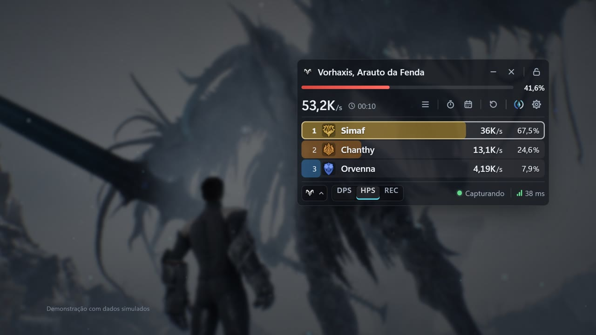

# AionCore

**HUD, guia em português e medidor de DPS para o Aion 2.**

[**⬇ Baixar a última versão**](https://github.com/filvoch/AionCoreUpdate/releases/latest/download/AionCore-Setup.exe) · [Todas as versões](https://github.com/filvoch/AionCoreUpdate/releases) · [Site](https://aioncore.pages.dev)

▶ *Clique na imagem para assistir à apresentação (1m53s, dados simulados).*

## O que é

- **Início**: um painel sobre o jogo com Guia, YouTube, DPS Meter e Atalhos.
- **Guia**: tradução completa para PT-BR do guia de Kanon, com busca, abas por capítulo e vídeos do YouTube dentro da janela.
- **AionCore Meter**: medidor de dano e cura em tempo real, com chefes, histórico de lutas, relógio dos eventos e avisos.
- **Atalhos globais** que funcionam por cima do jogo (abrir o Início, o guia, o medidor, mostrar/ocultar; dá para trocar em Início › Atalhos).

## Como instalar

1. [Baixe o instalador](https://github.com/filvoch/AionCoreUpdate/releases/latest/download/AionCore-Setup.exe) (sempre a versão mais recente; notas em [Releases](https://github.com/filvoch/AionCoreUpdate/releases/latest)) e execute.
2. Instale o [Npcap](https://npcap.com) uma vez, marcando *Install Npcap in WinPcap API-compatible Mode* e *Support loopback traffic*. É só para o medidor ler os pacotes do jogo.
3. Abra o AionCore pelo atalho. No Aion 2, use **modo janela** ou **janela sem bordas**: overlays não aparecem sobre tela cheia exclusiva.

## Atualizações

O AionCore se atualiza sozinho: consulta este repositório, confere a assinatura digital do instalador e instala quando o Aion 2 está fechado. Você pode forçar em *Atualizar agora*. Seus dados e configurações ficam guardados entre as versões.

## Este repositório

Guarda apenas os instaladores publicados (aba [Releases](https://github.com/filvoch/AionCoreUpdate/releases)) e esta página. O código-fonte não é público.

## Créditos

AionCore por **Guilherme Filvoch (Simavi)**. Guia original por [Kanon](https://www.youtube.com/@kanonxo), traduzido para PT-BR por Simavi.
Projeto de fã, sem vínculo com a NCSOFT. Aion 2 e seus ícones e imagens são marcas e arte da NCSOFT.
