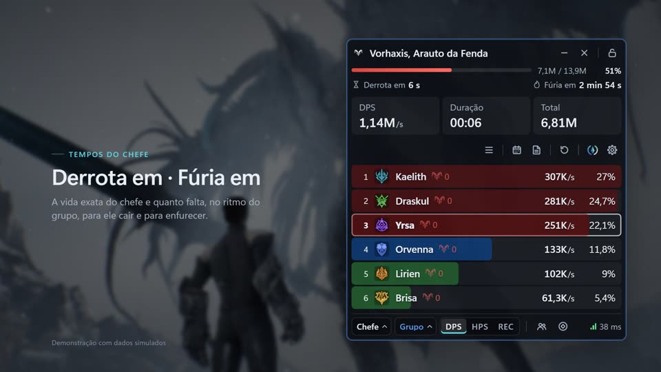
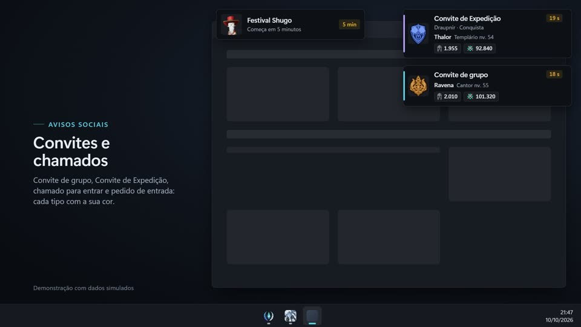
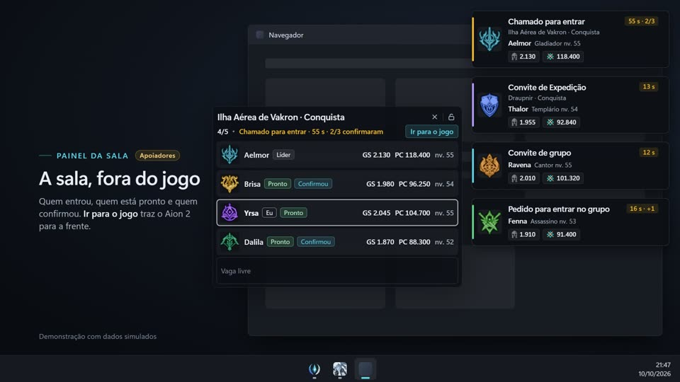

<div align="center">

<picture>
  <source media="(prefers-color-scheme: dark)" srcset="media/aioncore-logo-dark.svg">
  <source media="(prefers-color-scheme: light)" srcset="media/aioncore-logo-light.svg">
  
</picture>

**HUD, guia em português e medidor de DPS para o Aion 2.**

[](https://github.com/filvoch/AionCoreUpdate/releases/latest)


[**⬇ Baixar a última versão**](https://github.com/filvoch/AionCoreUpdate/releases/latest/download/AionCore-Setup.exe) · [Todas as versões](https://github.com/filvoch/AionCoreUpdate/releases) · [Site](https://aioncore.pages.dev)


<sub>Dados simulados.</sub>

</div>

> [!NOTE]
> O medidor precisa do [Npcap](https://npcap.com) e o Aion 2 deve estar em **modo janela** ou **janela sem bordas**. Detalhes em [Como instalar](#como-instalar).

## O que é

- **AionCore Meter**: medidor de dano e cura em tempo real, com tempo para derrotar o chefe, mortes, histórico de lutas e comparação entre lutas.
- **Avisos fora do jogo**: convites de grupo e de Expedição, chamados para entrar e avisos de chefe e evento aparecem por cima de qualquer janela. Ao clicar, o AionCore traz o jogo para a frente (ele nunca clica nem aceita nada por você).
- **Guia**: tradução completa para PT-BR do guia de Kanon, com busca, abas por capítulo e vídeos do YouTube dentro da janela.
- **Início e atalhos globais**: um painel sobre o jogo com Guia, YouTube e DPS Meter; os atalhos funcionam por cima do jogo e dá para trocar em Início › Atalhos.

<table>
  <tr>
    <td width="33%"></td>
    <td width="33%"></td>
    <td width="33%"></td>
  </tr>
  <tr>
    <td align="center"><sub>Medidor · visual Faixas</sub></td>
    <td align="center"><sub>Avisos fora do jogo</sub></td>
    <td align="center"><sub>Painel da sala</sub></td>
  </tr>
</table>

## Como instalar

Requisitos: Windows 10 (1809 ou mais novo) ou 11, 64 bits.

1. [Baixe o instalador](https://github.com/filvoch/AionCoreUpdate/releases/latest/download/AionCore-Setup.exe) (sempre a versão mais recente; notas em [Releases](https://github.com/filvoch/AionCoreUpdate/releases/latest)) e execute. Se o Windows mostrar "O Windows protegeu o computador", veja [a pergunta sobre o aviso](#perguntas-frequentes).
2. Instale o [Npcap](https://npcap.com) uma vez, marcando *Install Npcap in WinPcap API-compatible Mode* e *Support loopback traffic*. É só para o medidor ler os pacotes do jogo.
3. Abra o AionCore pelo atalho. No Aion 2, use **modo janela** ou **janela sem bordas**: overlays não aparecem sobre tela cheia exclusiva.

## Atualizações

O AionCore se atualiza sozinho: consulta este repositório, confere a assinatura digital do instalador e instala quando o Aion 2 está fechado. Você pode forçar em *Atualizar agora*. Seus dados e configurações ficam guardados entre as versões.

## Perguntas frequentes

<details>
<summary><b>Dá ban?</b></summary>

O medidor lê o tráfego de rede do seu PC e o título da janela do jogo. Não altera arquivos nem a memória do jogo. Mesmo assim, nenhuma ferramenta desse tipo pode garantir o que a política do jogo decide: o risco do uso é seu.
</details>

<details>
<summary><b>É grátis?</b></summary>

Sim, o AionCore é gratuito, sem anúncios. Existe um apoio opcional (valor único por ano) que libera novidades antes para quem apoia. O que já foi publicado grátis continua grátis.
</details>

<details>
<summary><b>Quais servidores e regiões funcionam?</b></summary>

Feito e testado no Aion 2 Global (servidor 2404 Lumiel, América do Sul). Em outras regiões (Taiwan, Coreia) pode funcionar, mas ainda não é garantido.
</details>

<details>
<summary><b>O que preciso instalar?</b></summary>

Windows 10 (1809 ou mais novo) ou 11, 64 bits, e o [Npcap](https://npcap.com), que o medidor usa para ler os pacotes do jogo. No instalador do Npcap, marque o modo compatível com WinPcap e o suporte a loopback. O medidor também usa o WebView2, que já vem no Windows 11. O instalador do AionCore avisa se faltar algo, mas não baixa nem instala nada de terceiros.
</details>

<details>
<summary><b>Precisa rodar como administrador?</b></summary>

Não. O AionCore instala só para o seu usuário e nunca pede administrador sozinho. Se o seu Npcap foi instalado com a opção *Restrict Npcap driver's access to Administrators only*, o medidor mostra o botão **Reabrir como administrador** (vale só daquela vez). Para nunca precisar, reinstale o Npcap sem marcar essa opção.
</details>

<details>
<summary><b>O medidor some quando o jogo está na frente.</b></summary>

O jogo está em **Tela cheia** exclusiva, e o Windows não mostra janelas por cima dela. Nas opções de vídeo do Aion 2, troque para **Janela sem bordas**.
</details>

<details>
<summary><b>O Windows ou o antivírus avisou ao instalar.</b></summary>

O instalador não tem assinatura digital paga, então o Windows não conhece o editor e mostra "O Windows protegeu o computador". Clique em **Mais informações** e depois em **Executar assim mesmo**. Um antivírus pode pedir confirmação pelo mesmo motivo. Para conferir que o arquivo é o original, compare o SHA-256 que está em `latest.json` (nos Assets da versão) com o resultado de:

```powershell
Get-FileHash .\AionCore-Setup.exe
```
</details>

<details>
<summary><b>O que sai do meu PC?</b></summary>

As lutas não saem do PC sem você ligar o envio (opcional, desligado por padrão). O medidor baixa os ícones das habilidades da CDN do jogo e consulta este repositório para saber se há versão nova. A atualização automática nunca instala com o Aion 2 aberto.
</details>

<details>
<summary><b>Como desinstalo? Perco meus dados?</b></summary>

*Configurações do Windows › Aplicativos instalados › AionCore*. O desinstalador pergunta se apaga também seus dados (histórico, configurações); por padrão, mantém. Instalar uma versão nova por cima também mantém tudo.
</details>

<details>
<summary><b>É oficial?</b></summary>

Não. É um projeto independente, feito por um jogador, sem afiliação nem endosso da NCSOFT. Aion 2, seus ícones, nomes e artes pertencem à NCSOFT e a seus licenciantes.
</details>

## Este repositório

Guarda apenas os instaladores publicados (aba [Releases](https://github.com/filvoch/AionCoreUpdate/releases)) e esta página. O código-fonte não é público.

## Créditos

AionCore por **Guilherme Filvoch (Simavi)**. Guia original por [Kanon](https://www.youtube.com/@kanonxo), traduzido para PT-BR por Simavi.
Projeto de fã, sem vínculo com a NCSOFT. Aion 2 e seus ícones e imagens são marcas e arte da NCSOFT.
